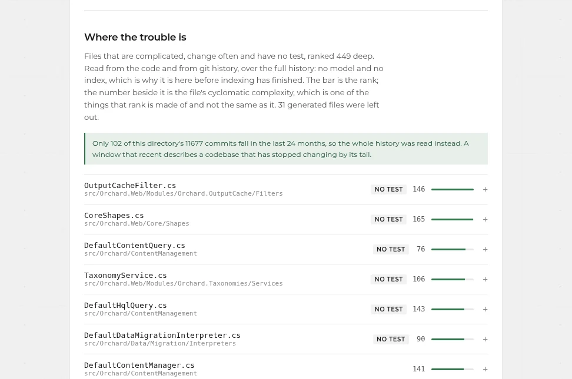

# Legacy Lens

**Know what your .NET Framework application is made of.**

Legacy Lens reads a whole inherited .NET solution on your own machine, without
building it and without sending a line anywhere, and hands back a measured
report: what is there, what will hurt, what blocks a move to modern .NET, and in
what order to deal with it.

**Site:** [liquidsnake0.github.io/legacy-lens-site](https://liquidsnake0.github.io/legacy-lens-site/)
· [français](https://liquidsnake0.github.io/legacy-lens-site/fr/)
· [Deutsch](https://liquidsnake0.github.io/legacy-lens-site/de/)

## What the report says

- **The map.** Every project, every dependency, every package with a known path
  to modern .NET and every one without.
- **Where the code is entered.** Controllers, actions, WCF operations, jobs,
  handlers: 1,656 entry points on nopCommerce 3.90, 629 on Orchard. Including
  the public methods MVC routes to without anybody having meant them as actions:
  508 on nopCommerce, one of them a directory download reachable by URL
  without the permission check its official entry point makes.
- **The danger zone.** Which types carry the most behaviour, change most often
  and are tested least, ranked, so a reader knows where to look first.
- **The decisions.** What is mechanical and can be converted today, and the
  handful of things only the owners can decide, asked as closed questions.
- **The safety net.** Characterization tests written from what the code does
  now, verified by the compiler before anyone sees them.

A full report on Orchard, a real 300,000-line codebase, is here:
[sample/orchard](sample/orchard/) ([PDF](sample/orchard/orchard-assessment.pdf)).

## How it runs

On your machine. The whole analysis runs from the source tree, so it works on a
solution that no longer builds, which is the state an inherited codebase is in
on the first day. A report on Orchard takes about twelve seconds. Nothing is
uploaded, nothing is hosted, no account is needed.

## Who

[Selim](https://github.com/LiquidSnake0), senior .NET engineer, contributor to
ILSpy and to REA. Legacy Lens is his work; the source is private. To see it run
on your own code: [LinkedIn](https://www.linkedin.com/in/selim-selimi-4a2b55172/).
